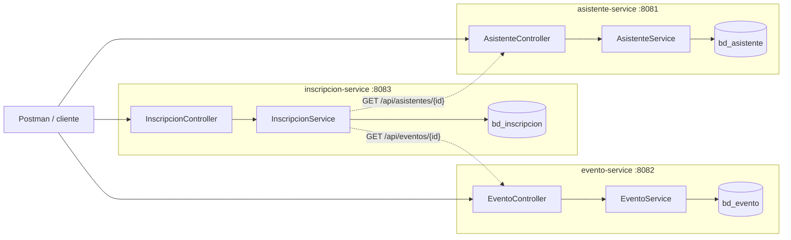

# Evaluación 03 — Sistema de Gestión de Eventos (Microservicios)

**Estudiante:** Reyes Saravia, Jordan Arturo  **Curso:** Desarrollo de aplicaciones Web — Evaluación N° 03
**Tema asignado (N.º 15):** Gestión de eventos → Evento, Asistente, Inscripción

Tres microservicios independientes con Spring Boot 4.1 + Spring Data JPA + MySQL. Cada uno tiene su propio puerto y su propia base de datos; entre ellos solo se referencian por **ID**.

## Diagrama



| Servicio | Responsabilidad | Puerto dev / prod | Base de datos (dev / prod) |
|---|---|---|---|
| `asistente-service` | CRUD de asistentes (documento único, correo, estado) | 8081 / 9091 | `bd_asistente_dev` / `bd_asistente` |
| `evento-service` | CRUD de eventos (nombre, lugar, fecha, capacidad, estado) | 8082 / 9092 | `bd_evento_dev` / `bd_evento` |
| `inscripcion-service` | Registra inscripciones (idEvento, idAsistente, fecha, estado) y valida contra los otros dos por HTTP | 8083 / 9093 | `bd_inscripcion_dev` / `bd_inscripcion` |

## Requisitos
- JDK 25 (o 21+ cambiando `java.version` en el `pom.xml`), Maven (cada proyecto trae `mvnw`)
- MySQL en `localhost:3306`, usuario `root` sin contraseña (como en la guía)
- Postman

## Pasos de ejecución
1. (Opcional) ejecutar `sql/bases_de_datos.sql` en MySQL. Si no se hace, el perfil **dev** crea la base solo (`createDatabaseIfNotExist=true`) y Hibernate crea las tablas.
2. Abrir la carpeta `microservicios` en IntelliJ y ejecutar la clase principal de cada servicio, **o** por consola en tres terminales:
   ```bash
   cd asistente-service   && ./mvnw spring-boot:run
   cd evento-service      && ./mvnw spring-boot:run
   cd inscripcion-service && ./mvnw spring-boot:run
   ```
   Arrancar `asistente` y `evento` antes de usar `inscripcion` (si alguno está caído, inscripción responde 503).
3. Importar `postman/Eventos-Microservicios.postman_collection.json` en Postman y ejecutarla con **Runner** (en orden). Cada request verifica su código HTTP esperado.

## Páginas web (una por servicio)
Cada servicio sirve su propia página (`src/main/resources/static/index.html`) con formulario, listado, editar y eliminar:

| Página | URL |
|---|---|
| Asistentes | http://localhost:8081/ |
| Eventos | http://localhost:8082/ |
| Inscripciones | http://localhost:8083/ (carga eventos y asistentes de los otros dos; botón *Cancelar* libera el cupo) |

Diseño: encabezado con ilustración propia (`static/img/hero.svg`), estadísticas, buscador, tarjetas con portadas e iniciales generadas en SVG, entradas tipo ticket para las inscripciones, barra de cupos en los eventos y formulario en ventana emergente. No usa librerías ni imágenes externas.

Cada servicio incluye `config/CorsConfig.java`, que permite que la página de un puerto consulte las APIs de los otros.

## Perfiles dev / prod (YAML)
`application.yml` solo fija `spring.profiles.active: dev`. Lo que cambia entre ambientes:

| Valor | `application-dev.yml` | `application-prod.yml` |
|---|---|---|
| Puerto | 8081 / 8082 / 8083 | 9091 / 9092 / 9093 |
| Base de datos | `localhost/bd_xxx_dev` | `${DB_HOST:servidor}/bd_xxx` |
| Usuario / clave | `root` / vacía | `${DB_USER}` / `${DB_PASSWORD}` (variables de entorno, sin credenciales en el código) |
| `show-sql` | true | false |
| `empresa.ambiente` | desarrollo | produccion |
| URL de otros servicios (solo inscripción) | `localhost:8081` / `8082` | `${ASISTENTE_URL}` / `${EVENTO_URL}` |

Para ejecutar en prod: `./mvnw spring-boot:run -Dspring-boot.run.profiles=prod`.

## Endpoints

**asistente-service — `http://localhost:8081/api/asistentes`**
| Método | Ruta | Descripción | Respuestas |
|---|---|---|---|
| GET | `/api/asistentes` | Listar | 200 |
| GET | `/api/asistentes/{id}` | Buscar por ID | 200 / 404 |
| POST | `/api/asistentes` | Registrar | 201 / 400 / 409 (documento repetido) |
| PUT | `/api/asistentes/{id}` | Actualizar | 200 / 400 / 404 / 409 |
| DELETE | `/api/asistentes/{id}` | Eliminar | 200 / 404 |

**evento-service — `http://localhost:8082/api/eventos`**
| Método | Ruta | Descripción | Respuestas |
|---|---|---|---|
| GET | `/api/eventos?nombre=&estado=` | Listar / buscar por nombre o estado | 200 |
| GET | `/api/eventos/{id}` | Buscar por ID | 200 / 404 |
| POST | `/api/eventos` | Registrar | 201 / 400 |
| PUT | `/api/eventos/{id}` | Actualizar | 200 / 400 / 404 |
| DELETE | `/api/eventos/{id}` | Eliminar | 200 / 404 |

**inscripcion-service — `http://localhost:8083/api/inscripciones`**
| Método | Ruta | Descripción | Respuestas |
|---|---|---|---|
| GET | `/api/inscripciones?idEvento=&idAsistente=` | Listar / filtrar | 200 |
| GET | `/api/inscripciones/{id}` | Buscar por ID | 200 / 404 |
| POST | `/api/inscripciones` | Inscribir | 201 / 400 / 404 (evento o asistente no existe) / 409 / 503 |
| PUT | `/api/inscripciones/{id}` | Cambiar fecha/estado | 200 / 400 / 404 / 409 |
| PATCH | `/api/inscripciones/{id}/estado` | Cambiar solo el estado (p. ej. cancelar) | 200 / 400 / 404 / 409 |
| DELETE | `/api/inscripciones/{id}` | Eliminar | 200 / 404 |

### Cuerpos de ejemplo
```json
// POST /api/asistentes
{ "documento": "70123456", "nombres": "Ana", "apellidos": "Torres Vega", "correo": "ana@mail.com", "telefono": "987654321", "estado": "ACTIVO" }

// POST /api/eventos
{ "nombre": "Congreso de Tecnologia 2026", "lugar": "Centro de Convenciones, Lima", "fecha": "2026-12-10", "capacidad": 2, "estado": "ACTIVO" }

// POST /api/inscripciones
{ "idEvento": 1, "idAsistente": 1, "fecha": "2026-11-05", "estado": "CONFIRMADA" }
```

## Validaciones y reglas de negocio
- **Evento:** nombre y lugar obligatorios, fecha obligatoria (`yyyy-MM-dd`), **capacidad > 0**, estado ∈ `ACTIVO | CANCELADO | FINALIZADO`.
- **Asistente:** documento (8–15), nombres, apellidos, correo válido, estado ∈ `ACTIVO | INACTIVO`.
- **Inscripción:** idEvento, idAsistente, fecha y estado (`PENDIENTE | CONFIRMADA | CANCELADA`) obligatorios. Además:
  - el evento y el asistente deben existir (si no → **404**);
  - el evento debe estar `ACTIVO` y el asistente `ACTIVO` (→ **409**);
  - un asistente no puede inscribirse dos veces al mismo evento (→ **409**);
  - no se puede superar la **capacidad** del evento; las inscripciones `CANCELADA` liberan cupo (→ **409**);
  - una inscripción `CANCELADA` no se reactiva (→ **409**).

Formato de errores: `{"codigo":"404","mensaje":"Evento no encontrado con id: 999"}`; para validaciones: `{"codigo":"400","mensaje":"Datos invalidos","errores":{"capacidad":"La capacidad debe ser mayor a 0"}}`.

## Estructura de cada proyecto
`com.tecsup` → `controller` · `model` · `dto` · `exception` · `repository` · `services` (+ `client` en inscripción, con las llamadas HTTP a los otros servicios).

## Pruebas realizadas
Se levantaron los tres servicios contra MySQL/MariaDB y se ejecutó el flujo completo: registro de asistente, evento e inscripción (201), ID inexistente (404), datos inválidos (400), duplicado / cupo lleno / asistente inactivo (409) y `evento-service` apagado (503). Todos devolvieron el código esperado.
Para las capturas de la entrega: ejecutar la colección de Postman y tomar captura del Runner y de al menos un caso exitoso y uno de error.

## Conclusiones (5 aprendizajes)
1. Separar Evento, Asistente e Inscripción en servicios permite desarrollarlos, desplegarlos y escalarlos por separado; si uno cae, los otros siguen respondiendo.
2. Cada servicio con su propia base de datos evita el acoplamiento por tablas: no hay llaves foráneas entre bases, solo IDs, y la integridad se valida consultando por HTTP al servicio dueño del dato.
3. La comunicación entre servicios depende de la red, por eso se manejan los casos "no existe" (404) y "servicio caído" (503) con respuestas claras en lugar de errores 500.
4. La arquitectura por capas (controller, service, repository), los DTO con Bean Validation y un `GlobalExceptionHandler` mantienen el código ordenado y las respuestas de error consistentes.
5. Los YAML con perfiles dev/prod permiten cambiar puertos, bases, logs y URLs sin tocar el código, y las credenciales de producción se leen de variables de entorno.

**Dificultad y solución:** la inscripción debía validar cupo y existencia de datos que están en otras bases. Al no poder usar un `JOIN` ni una llave foránea, se resolvió con un cliente `RestClient` que consulta `evento-service` y `asistente-service`, y con consultas del repositorio (`countByIdEventoAndEstadoNot`) para calcular los cupos ocupados.

## Pregunta de sustentación
- **¿Por qué estos servicios?** Evento, Asistente e Inscripción tienen ciclos de vida y responsabilidades distintas; la inscripción es la que relaciona a los otros dos.
- **¿Cómo persiste?** Entidades JPA (`@Entity`) + `JpaRepository` sobre MySQL; Hibernate crea/actualiza las tablas (`ddl-auto: update`).
- **¿Qué pasa con datos inválidos?** `@Valid` en el DTO lanza `MethodArgumentNotValidException`; el `GlobalExceptionHandler` la convierte en un HTTP 400 con el detalle por campo. Los IDs inexistentes devuelven 404.
